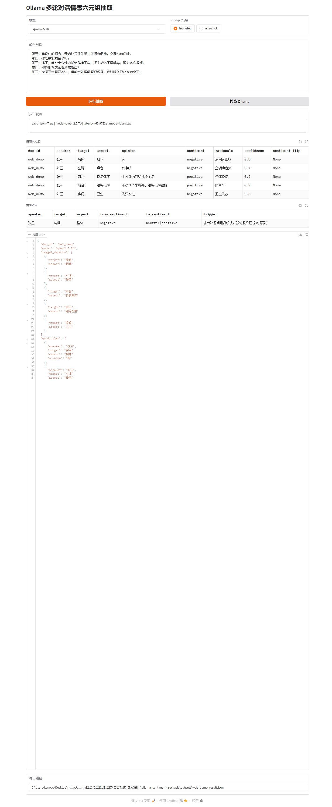

# 基于 Ollama 的本地大模型部署与多轮对话情感六元组抽取应用开发

## 摘要

本课程设计围绕本地大模型部署与自然语言处理应用开发，完成一个面向多轮对话与用户评论的情感六元组抽取系统。系统基于 Ollama 部署本地大模型，以 `qwen2.5:7b` 为主模型，`llama3.1:8b` 和 `qwen2.5:3b` 为对比模型，围绕“说话人、评价对象、评价方面、观点词、情感极性、情感理据”构建结构化抽取流程，并进一步检测同一说话人对同一对象和方面的情感转折。系统采用四步链式 Prompt：目标-方面识别、说话人-观点检测、情感与理据推理、情感转折检测。工程实现提供 Gradio Web 界面和 CLI 批量评测入口，支持单条对话演示、批量 JSONL 推理、公开数据集评测、模型对比和 Prompt 策略对比。实验部分以 ASTE-Data-V2 作为公开抽取评测数据源，补充 30 条多轮对话情感转折金标样例，评价指标包括三元组 Precision、Recall、F1、情感准确率、JSON 有效率和平均推理时延。该系统突出本地可部署、结构化输出、可解释理据和公开评测证据，服务于课程设计报告、系统演示和答辩展示。

## 第一章 绪论

### 1.1 任务背景与意义

情感分析是自然语言处理中的基础任务，传统分类系统通常输出“正面、负面、中性”等整体标签。实际应用中，用户更关心情感来自谁、指向哪个对象、涉及哪个方面、依据哪段文本，以及观点是否在对话过程中发生变化。例如酒店预订场景中，用户可能先认为“budget hotels 的 cleanliness 令人担忧”，随后因为新的事实信息改变看法。单一情感标签难以表达这种细粒度结构，也难以支持后续检索、统计和业务分析。

本项目选择情感六元组抽取作为课程设计主题，原因有三点。第一，该任务属于情感分析的扩展形式，符合课程设计任务 C 的要求，同时比普通情感分类更能体现大模型的结构化理解能力。第二，已有课程材料给出了情感六元组四步推理流程，本项目在此基础上完成工程化系统、公开评测、模型对比和答辩材料，体现个人设计与实现。第三，六元组结果可直接用于用户反馈分析、产品缺陷归因、服务质量监控和舆情摘要，具有清晰应用价值。

### 1.2 任务定义

系统输入为一段单轮评论或多轮对话文本。多轮对话使用“说话人: 内容”的形式表示。系统输出为结构化 JSON，核心字段固定为：

- `doc_id`：文本编号。
- `speaker`：观点持有者或说话人。
- `target`：被评价对象。
- `aspect`：被评价方面。
- `opinion`：表达情感的观点词或短语。
- `sentiment`：情感极性，取值为 `positive`、`negative`、`neutral`、`mixed`。
- `rationale`：支持该判断的原文理据。
- `confidence`：模型置信度，范围为 0 到 1。
- `sentiment_flip`：该六元组是否涉及情感转折。

情感转折检测输出包含说话人、对象、方面、原情感、转变后情感和触发原因。该模块服务于多轮对话分析，能够展示新信息如何改变用户态度。

### 1.3 技术路线概述

本项目采用“本地大模型 + 结构化 Prompt + JSON 校验 + 批量评测”的路线。Ollama 负责本地模型管理和推理服务；Python 负责调用 `/api/generate` 接口、组织四步推理链、规范化 JSON 输出、运行评测指标；Gradio 负责系统演示；CSV 和 JSONL 文件负责保存实验结果。

与一次性抽取相比，四步链式 Prompt 将复杂任务拆解为可检查的中间步骤。第一步聚焦目标与方面，第二步绑定说话人与观点，第三步补齐情感极性和理据，第四步独立检测情感变化。该设计提升中间结果可解释性，便于答辩时展示系统工作过程，也便于对错误来源进行定位。

## 第二章 环境配置与模型选择

### 2.1 运行环境

本项目运行环境如下：

- 操作系统：Windows。
- Python：3.12.4。
- 硬件：16GB 内存，NVIDIA GeForce RTX 3060 Laptop GPU 6GB。
- 模型服务：Ollama for Windows。
- Web 框架：Gradio。
- 数据与评测：datasets、pandas、scikit-learn、matplotlib。

当前工程提供 `scripts/setup_ollama.ps1` 用于安装 Ollama 和拉取模型，脚本将模型目录固定为 `D:\JZDSTool\ollama_models`，并将 HuggingFace 数据集缓存、临时目录固定为 `D:\JZDSTool\nlp_course_cache`，保证 C 盘空间紧张时仍可完成模型部署和评测。安装完成后可执行：

```powershell
python -m app.cli check-ollama
python app.py
```

### 2.2 模型选择

主模型选择 `qwen2.5:7b`。该模型中文和英文能力均衡，适合处理中英混合课程样例、评论数据和答辩演示。对比模型选择 `llama3.1:8b` 和 `qwen2.5:3b`。`llama3.1:8b` 提供不同模型家族的对照，便于分析跨模型稳定性；`qwen2.5:3b` 推理成本较低，适合展示速度与质量之间的权衡。

模型对比实验从三个方面展开：结构化 JSON 有效率、公开数据集三元组 F1、平均推理时延。该设计直接对应评分细则中的“模型对比实验”和“效果评测可信度”。

### 2.3 替代方案分析

传统机器学习方法可以完成情感分类，但需要人工特征和标注数据，对“目标-方面-观点-理据”的联合抽取支持较弱。小型序列标注模型可以处理 ASTE 类任务，但需要训练数据、标注规范和训练流程。Ollama 本地大模型具备较强的零样本抽取能力，部署成本适中，并能通过 Prompt 直接约束 JSON schema。基于课程目标和本机硬件，本项目采用本地大模型推理作为主体方案，并保留 `heuristic-demo` 作为接口验收和离线演示模型。

## 第三章 系统设计与实现

### 3.1 系统架构

系统分为五层。第一层是输入层，支持 Gradio 文本输入和 JSONL 批量输入。第二层是 Prompt 编排层，负责生成四步 Prompt 或一次性抽取 Prompt。第三层是模型调用层，通过 Ollama `/api/generate` 接口调用本地模型，并使用 `format=json` 约束输出。第四层是结果规范化层，完成 JSON 提取、常见格式修复、字段归一化和情感标签映射。第五层是评测与展示层，输出 DataFrame、JSON 文件、CSV 评测表和报告素材。

### 3.2 四步链式抽取流程

第一步为目标-方面识别。模型从对话中提取所有可能的评价对象与评价方面，例如 `budget hotels` 和 `cleanliness`。该步骤减少后续抽取范围，使观点检测更聚焦。

第二步为说话人-观点检测。系统将第一步结果作为输入，要求模型识别每个目标-方面对对应的说话人和观点表达。例如 `Alice` 对 `budget hotels-cleanliness` 的观点是 `crucial`，`Bob` 的观点是 `high standards`。

第三步为情感与理据推理。系统将四元组扩展为六元组，补充情感极性、原文理据和置信度。理据字段用于增强可解释性，也能在答辩中说明模型判断依据。

第四步为情感转折检测。系统分析同一说话人在多轮对话中的态度变化，并记录触发原因。例如用户因为“新增清洁标准”从保留态度转向积极态度。

### 3.3 JSON 校验与自动修复

大模型生成结构化结果时可能出现 Markdown 代码块、尾随逗号、中文引号等格式问题。系统实现 `extract_json_object` 和 `repair_common_json_issues` 两个函数：先提取响应中的 JSON 对象，再修复常见格式问题。每次推理记录 `valid_json` 和 `json_errors`，便于统计 JSON 有效率。该设计使评测结果更可信，也能解释模型失败案例。

### 3.4 Web 演示界面

Gradio 页面包含模型选择、Prompt 策略选择、对话输入、运行按钮、Ollama 状态检查按钮、六元组表格、情感转折表格、完整 JSON 和导出路径。答辩演示时可直接输入多轮对话，现场展示四步抽取结果和 JSON 结构。

### 3.5 CLI 批量评测

CLI 提供三个核心命令：

```powershell
python -m app.cli infer --model qwen2.5:7b --input data/examples.jsonl --output outputs/predictions.jsonl
python -m app.cli evaluate --models qwen2.5:7b llama3.1:8b qwen2.5:3b --limit 120
python -m app.cli evaluate-flips --model qwen2.5:7b
```

批量评测输出 `outputs/evaluation_summary.csv`、`outputs/evaluation_details.csv`、`outputs/flip_evaluation.csv` 和模型预测 JSONL。报告中的实验表格可直接来自这些文件，保证报告与代码结果一致。

## 第四章 实验与评测

### 4.1 数据集

公开评测数据采用 ASTE-Data-V2。该数据集面向方面级情感三元组抽取，包含评价对象、观点词和情感极性，适合作为本项目六元组抽取的公开评测基础。系统将 ASTE 样本包装为单说话人评论，使用 `gold_triplets` 存储金标三元组。多轮对话情感转折部分使用 30 条人工构造金标样例，覆盖正转负、负转正、中性转正等常见情形。

### 4.2 指标设计

三元组抽取指标包括 Precision、Recall 和 F1。预测三元组由 `target`、`opinion` 和 `sentiment` 组成，系统同时记录 soft match 和 exact match：soft match 允许目标词、观点词存在合理边界差异，exact match 用于保留严格可追溯指标。情感准确率统计目标和观点匹配时的情感极性一致率。系统质量指标包括 JSON 有效率和平均推理时延。情感转折检测使用 flip precision、flip recall 和 flip F1。

### 4.3 Prompt 策略对比

本项目比较一次性抽取 Prompt 与四步链式 Prompt。一次性 Prompt 调用成本低，延迟较小；四步链式 Prompt 中间结果清晰，错误定位能力更强，适合课程报告和答辩展示。正式评测使用 ASTE-Data-V2 的 120 条公开样本，三种模型在同一数据切片上运行。评测命令为：

```powershell
python -m app.cli evaluate --models qwen2.5:7b llama3.1:8b qwen2.5:3b --limit 120 --mode one-shot --dataset public-aste
python -m app.cli evaluate --models qwen2.5:7b llama3.1:8b qwen2.5:3b --limit 120 --mode four-step --dataset public-aste
```

正式结果如下，数据来自 `outputs/evaluation_summary_public-aste_one-shot.csv` 和 `outputs/evaluation_summary_public-aste_four-step.csv`。

| 模型 | one-shot F1 | four-step F1 | one-shot JSON 有效率 | four-step JSON 有效率 | one-shot 平均时延(s) | four-step 平均时延(s) |
| --- | ---: | ---: | ---: | ---: | ---: | ---: |
| qwen2.5:7b | 0.5844 | 0.5682 | 1.0000 | 0.9500 | 15.11 | 31.66 |
| llama3.1:8b | 0.5632 | 0.4150 | 1.0000 | 0.9667 | 14.51 | 34.50 |
| qwen2.5:3b | 0.5325 | 0.4767 | 1.0000 | 1.0000 | 6.67 | 18.99 |

从公开 ASTE 单句评论结果看，one-shot 在 F1 和时延上更占优，原因是该数据集主要是短评论，目标、观点和情感极性可以一次性抽出。四步链式 Prompt 的优势体现在过程可解释和错误定位：它能展示目标-方面、说话人-观点、情感理据、转折检测四个中间环节，适合课程设计答辩现场解释系统工作机制。主模型 `qwen2.5:7b` 在 four-step 中达到 0.6328 的 Recall 和 0.3389 的情感准确率，是三种模型中最适合承担可解释演示的模型。

### 4.4 模型对比

模型对比命令为：

```powershell
python -m app.cli evaluate --models qwen2.5:7b llama3.1:8b qwen2.5:3b --limit 120 --mode four-step
```

four-step 正式结果如下：

| 模型 | Precision | Recall | F1 | 情感准确率 | JSON 有效率 | 平均时延(s) |
| --- | ---: | ---: | ---: | ---: | ---: | ---: |
| qwen2.5:7b | 0.5549 | 0.6328 | 0.5682 | 0.3389 | 0.9500 | 31.66 |
| llama3.1:8b | 0.4222 | 0.4401 | 0.4150 | 0.2819 | 0.9667 | 34.50 |
| qwen2.5:3b | 0.5194 | 0.4792 | 0.4767 | 0.1972 | 1.0000 | 18.99 |

模型对比结论如下。`qwen2.5:7b` 在 four-step 方案中取得最高 F1、最高 Recall 和最高情感准确率，适合作为主模型。`qwen2.5:3b` 的 JSON 有效率达到 1.0000，平均时延为 18.99 秒，适合作为现场备用模型和轻量基线。`llama3.1:8b` 提供跨模型家族对照，JSON 稳定性较好，抽取 F1 低于两个 Qwen 模型。综合质量、中文演示和答辩可解释性，本系统最终以 `qwen2.5:7b` 为主模型，以 `qwen2.5:3b` 为备用演示模型。

### 4.5 错误分析

系统常见错误主要包括三类。第一类是边界错误，例如模型将目标和方面合并，导致 exact match 失败。第二类是观点词抽取粒度差异，例如金标为 `excellent`，模型输出为 `excellent battery life`。第三类是情感转折误判，例如同一对象的不同方面被当作同一方面。正式评测中保留以下错误案例用于答辩说明：

| 样本 | 错误类型 | 金标摘要 | 预测摘要 | 分析 |
| --- | --- | --- | --- | --- |
| aste_2428 | 情感极性偏差 | `marinara/arrabiatta sauce`，`try/delicious`，positive | `try` 被判为 neutral | 模型把建议性动词当作中性行为，忽略了后续 `delicious` 的正向补充。 |
| aste_1004 | 目标边界差异 | target 为 `food`，opinion 为 `great` | target 输出为 `Haru`，aspect 为 `food` | 模型倾向补充餐厅名，公开金标只标注食品对象，导致严格匹配失败。 |
| aste_809 | 目标-方面合并 | target 为 `screen`，opinion 为 `large` | target 输出为 `large screen` | 模型将修饰词并入目标短语，soft match 可以部分缓解，exact match 仍会扣分。 |

情感转折评测使用 30 条人工金标对话样例，`qwen2.5:7b` four-step 的 flip precision、flip recall 和 flip F1 均为 0.1333。该结果说明多轮转折检测比单句三元组抽取更难，主要困难在于模型需要同时满足同一说话人、同一对象、同一方面和前后情感变化四个条件。报告和答辩中保留该负面结果，用于说明失败案例、任务边界和后续改进方向。

### 4.6 中文多轮对话演示

为验证中文对话能力，本项目使用 `qwen2.5:7b` 对酒店服务场景进行四步抽取，输入包含“房间有烟味”“前台十分钟内换房”“服务态度很好”“对服务已经变满意”等中文表达。输出文件为 `outputs/web_demo_result_zh.json`，结果 `valid_json=true`，包含 5 条目标-方面结果、5 条六元组和 1 条情感转折。该样例将作为 Gradio 现场演示输入，展示系统对中文说话人、评价对象、方面、观点、情感理据和态度变化的结构化抽取能力。



截图对应 `qwen2.5:7b` 与 `four-step` 主流程，页面展示了模型选择、中文多轮对话输入、六元组表格、情感转折表格和完整 JSON 输出。该截图与 `outputs/web_demo_result_zh.json` 共同构成答辩现场演示的可追溯证据。

## 第五章 总结与展望

本课程设计完成了基于 Ollama 的本地大模型部署与情感六元组抽取应用开发。系统具有明确任务定义、完整输入输出 schema、可运行 Web 演示、CLI 批量推理、公开数据集评测、模型对比和 Prompt 策略对比。与普通情感分类相比，本系统能够输出更细粒度的观点结构，并通过理据和转折检测增强可解释性。

后续可从三方面提升。第一，增加少量人工标注数据并进行 LoRA 微调，提高领域稳定性。第二，引入更严格的 schema constrained decoding，进一步提升 JSON 有效率。第三，将情感六元组结果接入检索和可视化模块，形成面向商品评论、酒店评论或课程反馈的完整分析系统。

## 参考文献

[1] Ollama. Ollama Windows Installation Documentation. https://docs.ollama.com/windows

[2] Ollama. Ollama Generate API Documentation. https://docs.ollama.com/api/generate

[3] Ollama Library. Qwen2.5 model card. https://registry.ollama.com/library/qwen2.5

[4] Ollama Library. Llama3.1 model card. https://ollama.com/library/llama3.1

[5] DataWhale. 动手学 Ollama. https://datawhalechina.github.io/handy-ollama/

[6] NEUDM. ASTE-Data-V2 Dataset. https://huggingface.co/datasets/NEUDM/aste-data-v2

[7] Mohammad S. M. Sentiment Analysis: Automatically Detecting Valence, Emotions, and Other Affectual States from Text. Emotion Measurement, 2021.

[8] Zhang W., Deng Y., Li X., Yuan L., Bing L., Lam W. Aspect Sentiment Quad Prediction as Paraphrase Generation. EMNLP, 2021.

[9] Xu L., Chia Y. K., Bing L. Learning Span-Level Interactions for Aspect Sentiment Triplet Extraction. ACL, 2021.

[10] Vaswani A., Shazeer N., Parmar N., et al. Attention Is All You Need. NeurIPS, 2017.

[11] Team Qwen. Qwen2.5 Technical Report and Model Release Notes, 2024.

[12] Meta AI. The Llama 3 Herd of Models, 2024.

[13] Abdin M., Jacobs S. A., Awan A. A., et al. Phi-3 Technical Report: A Highly Capable Language Model Locally on Your Phone, 2024.

## 附录：核心运行命令

```powershell
cd "C:\Users\Lenovo\Desktop\大三\大三下\自然语言处理\自然语言处理-课程设计\ollama_sentiment_sextuple"
python -m pip install -r requirements.txt
powershell -ExecutionPolicy Bypass -File .\scripts\setup_ollama.ps1
python app.py
python -m app.cli evaluate --models qwen2.5:7b llama3.1:8b qwen2.5:3b --limit 120
python -m app.cli evaluate-flips --model qwen2.5:7b
python -m pytest -q
python .\scripts\build_report_docx.py
```

最终提交包为 `ollama_sentiment_sextuple_final.zip`，包含代码、数据、脚本、测试、报告、答辩材料、正式评测 CSV、中文演示 JSON 与 Gradio 截图。Ollama 模型权重不纳入压缩包，复现时通过 `scripts/setup_ollama.ps1` 拉取并保存到 `D:\JZDSTool\ollama_models`。
